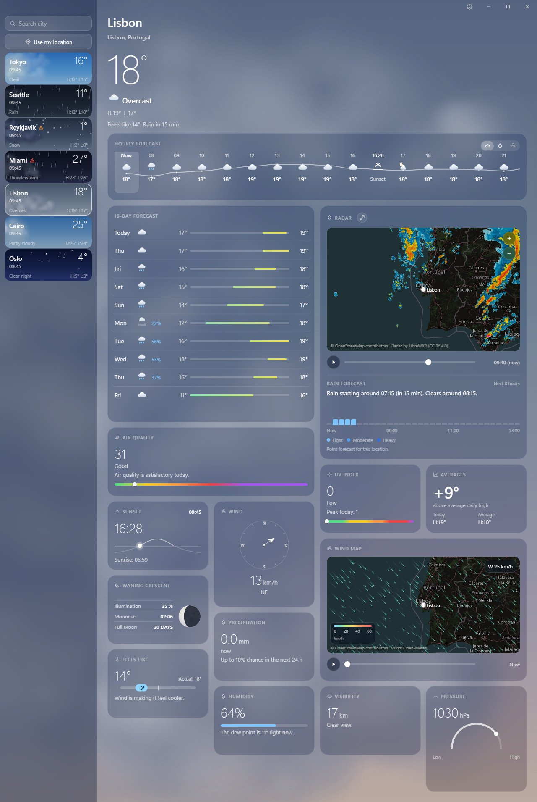

# Skylark

A lightweight weather app for Windows, inspired by the macOS Weather app. Lightweight first, modern UI second.

Built with Tauri 2 (WebView2), a Rust backend and a vanilla TypeScript + plain CSS frontend (Vite). No UI framework.


| Clear night | Snow | Thunderstorm |
|---|---|---|
|  |  |  |

| Day popover | Expanded radar |
|---|---|
|  |  |

All tiles:



## Features

- Current conditions, hourly strip (switch between conditions, chance of rain and wind), 10-day forecast, 15-minute rain nowcast
- Precipitation radar with a 60 minute nowcast, pan, zoom and play, and an expanded view that gives the map half the window
- Tiles for air quality, UV, sun, wind, moon phase, averages (today's high versus the 10-year normal), precipitation, feels like, humidity, visibility and pressure; each opens a popover next to it, and the 10-day rows and hourly card open a per-day Conditions popover
- Official weather alerts for the US (National Weather Service), Canada (Environment and Climate Change Canada), Germany (DWD) and the rest of Europe (MeteoAlarm): a coloured pill under the city name, a detail popover with the full text and instructions, a warning mark on the city in the sidebar, and optional system notifications for new moderate-or-worse warnings. The source is picked automatically from the location's country; European region names come from a Nominatim reverse lookup
- Wind map: animated streamlines over a dark map for the next 24 hours, coloured by speed
- Animated sky that follows the time of day: sun with a faint halo, moon, stars, clouds, rain (with droplets running down the tiles), snow, fog, lightning; optional 60 fps mode
- Weather icons as line drawings or in colour
- Saved cities with live local time and their own animated sky (drifting clouds, rain, snow, stars), search, and "Use my location" (IP based)
- Units: C/F, km/h, mph, m/s, 12/24 h; optional start with Windows (launches into the tray)
- Tray-resident: closing the window frees the webview (about 6 MB); the tray icon or a second launch brings it back, and the current location refreshes every 15 minutes in the background. "Keep ready when closed" hides the window instead, so it reopens instantly at the cost of about 110 MB

The release exe is about 5 MB; the installer is about 1.6 MB.

## Build

Requirements: Node.js, Rust (stable), and the [Tauri 2 prerequisites for Windows](https://tauri.app/start/prerequisites/) (WebView2 is preinstalled on Windows 11).

```bash
npm install
npm run tauri dev                      # run in development
npm run tauri build                    # installer in src-tauri/target/release/bundle
npm run tauri build -- --no-bundle     # just the exe
```

Rust checks: `cd src-tauri && cargo test && cargo clippy -- -D warnings`. Frontend: `npx tsc --noEmit`.

## Updates

Skylark checks GitHub Releases for a new version once a day and always asks before installing; "Check for updates" in Settings > About checks immediately. Installers are not code-signed, so Windows SmartScreen may warn on first install ("More info" -> "Run anyway").

## Data sources

- Weather, nowcast, air quality and geocoding: [Open-Meteo](https://open-meteo.com/) (CC BY 4.0; the free API is for non-commercial use)
- Radar: [LibreWXR](https://librewxr.net/) (CC BY 4.0; national radar composites plus a 60 minute nowcast; Italian radar © Radar-DPC)
- Alerts: [National Weather Service](https://www.weather.gov/documentation/services-web-api) (US), [Environment and Climate Change Canada](https://weather.gc.ca/) (Canada; Data Source: Environment and Climate Change Canada), the German Weather Service (DWD) via [Bright Sky](https://brightsky.dev/), and [MeteoAlarm](https://meteoalarm.org/) (EUMETNET) for the rest of Europe; European region names are resolved with [Nominatim](https://nominatim.openstreetmap.org/) © OpenStreetMap contributors. Alerts are shown as published, in an emergency follow your local authorities
- Map tiles: © [OpenStreetMap](https://www.openstreetmap.org/copyright) contributors
- IP location: [ipwho.is](https://ipwho.is/)

## Contributors

- [Ad1FPS](https://github.com/Ad1FPS): author, design direction and testing
- [Claude](https://claude.com/claude-code) (Anthropic): planning, architecture, code review and much of the implementation
- [DeepSeek](https://www.deepseek.com/): bulk code generation, from specs written and reviewed by Claude

## License

[MIT](LICENSE)
