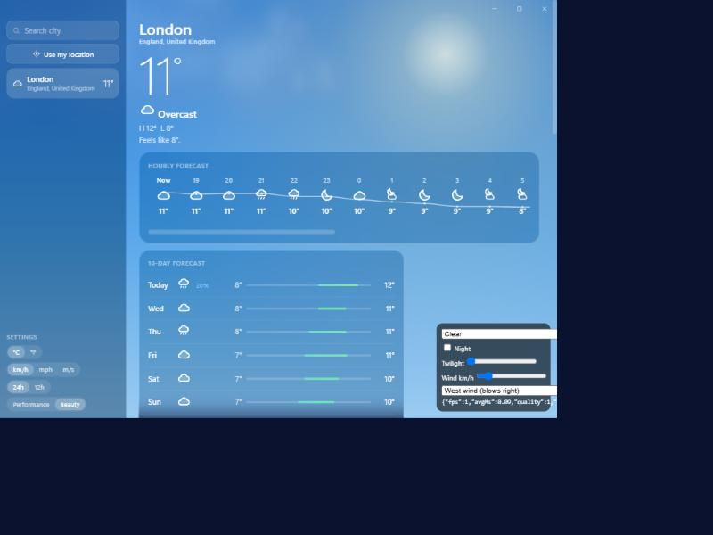
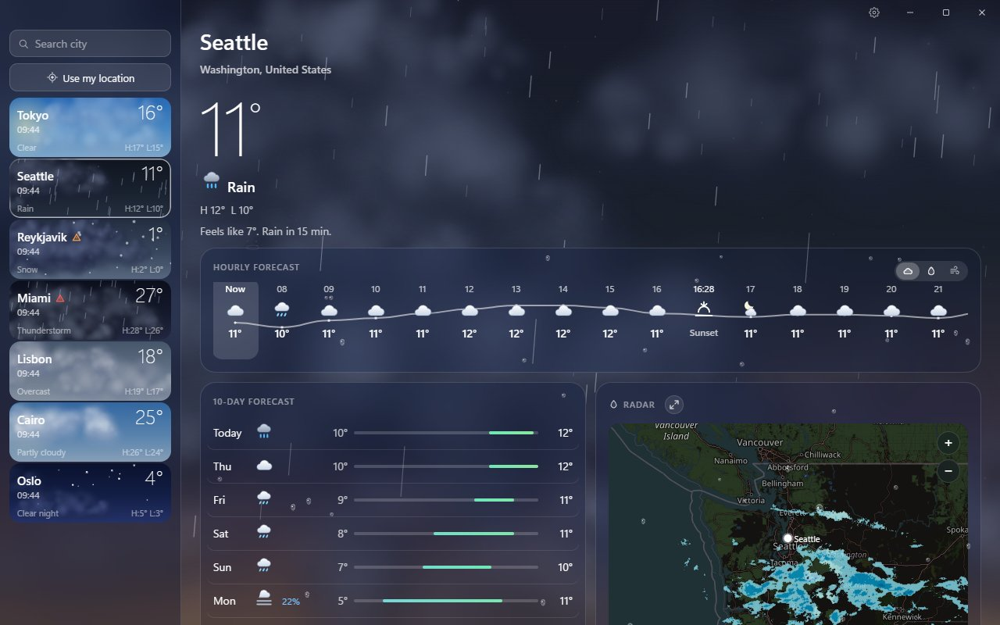
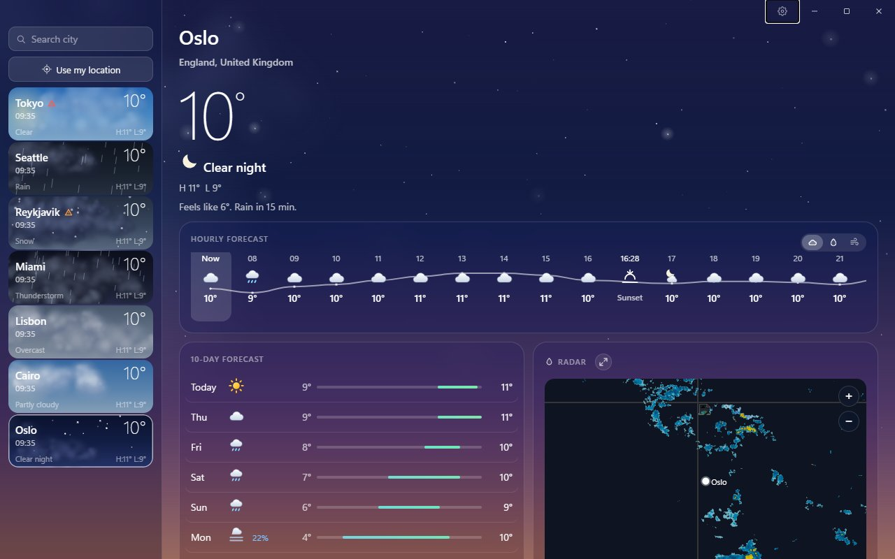
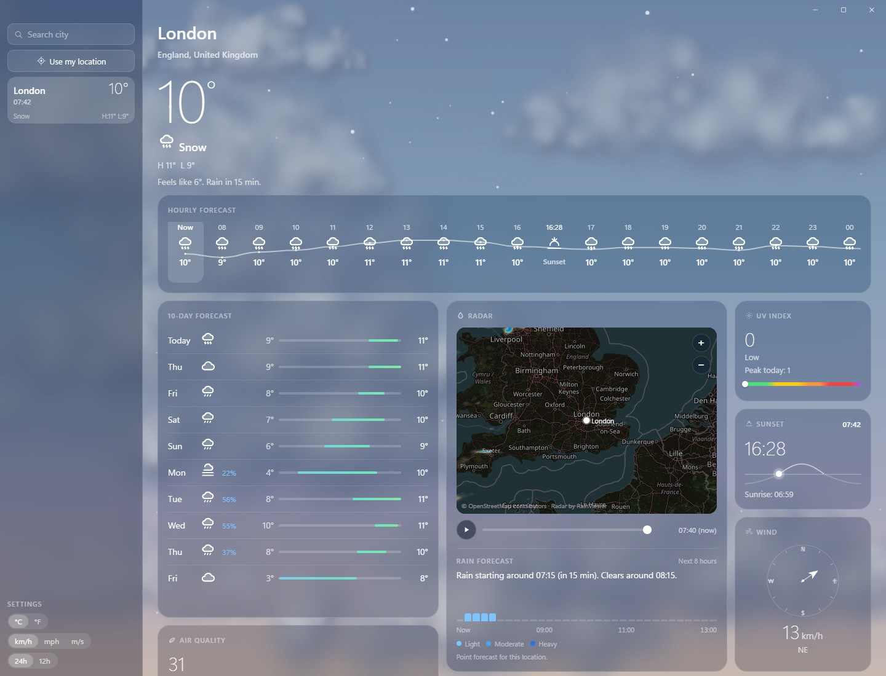
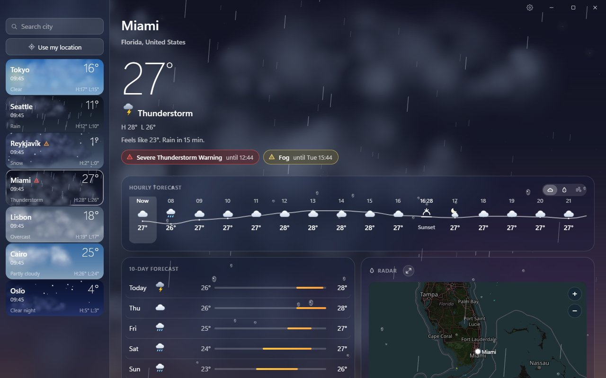

# Skylark

A lightweight weather app for Windows, inspired by the macOS Weather app. Lightweight first, modern UI second.

Built with Tauri 2 (WebView2), a Rust backend and a vanilla TypeScript + plain CSS frontend (Vite). No UI framework.





| Clear night | Snow | Thunderstorm |
|---|---|---|
|  |  |  |

## Features

- Current conditions, hourly strip, 10-day forecast, 15-minute rain nowcast
- Precipitation radar (past frames, pan, zoom, play)
- Nine info tiles (air quality, UV, sun, wind, precipitation, feels like, humidity, visibility, pressure), each opening a detail view with a 48-hour chart
- Animated sky: sun and moon travel with the time of day, stars, clouds, rain, snow, fog, lightning
- Saved cities with live local time, search, and "Use my location" (IP based)
- Units: C/F, km/h, mph, m/s, 12/24 h
- Tray-resident: closing the window frees the webview (about 6 MB); the tray icon or a second launch brings it back, and the current location refreshes every 15 minutes in the background

The release exe is about 5 MB; the installer is about 1.6 MB.

## Build

Requirements: Node.js, Rust (stable), and the [Tauri 2 prerequisites for Windows](https://tauri.app/start/prerequisites/) (WebView2 is preinstalled on Windows 11).

```bash
npm install
npm run tauri dev                      # run in development
npm run tauri build                    # installer in src-tauri/target/release/bundle
npm run tauri build -- --no-bundle     # just the exe
```

Rust checks: `cd src-tauri && cargo test && cargo clippy -- -D warnings`. Frontend: `npx tsc --noEmit`.

## Data sources

- Weather, nowcast, air quality and geocoding: [Open-Meteo](https://open-meteo.com/) (CC BY 4.0; the free API is for non-commercial use)
- Radar: [RainViewer](https://www.rainviewer.com/)
- Map tiles: © [OpenStreetMap](https://www.openstreetmap.org/copyright) contributors
- IP location: [ipwho.is](https://ipwho.is/)

## License

[MIT](LICENSE)
